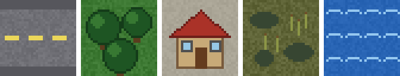

# Assignment 17 — Flyweight rendering for RPG (Flyweight pattern)

The RPG map generator from [Assignment 01](../Assignment01_FactoryMethod) now
draws its map on a JavaFX canvas. Making a map has two phases:

1. **Generate** the grid of `Tile` objects with the Factory Method, as before
   (`Game.createMap` → `CityMap` / `WildernessMap` → `createTile()`).
2. **Render** it with `MapRenderer`, which draws every cell with a
   **shared** tile graphic obtained from `TileGraphicFactory`. This is the
   **Flyweight** pattern.

*The five tile graphics (road, forest, building, swamp, water), drawn for this
assignment as 32 × 32 PNG files in `src/main/resources/tiles/`.*

## The pattern in this project

| Role (GoF / course slides) | Class | Responsibility |
|----------------------------|-------|----------------|
| **Flyweight** | `TileGraphic` | The graphic of one tile type. Stores the intrinsic state (type + image) and draws it at a position passed in by the caller. |
| **Flyweight factory** | `TileGraphicFactory` | Creates each graphic the first time it is asked for and returns the same object every later time. |
| **Client** | `MapRenderer` | Walks the map, asks the factory for the graphic of each tile's type and passes the extrinsic state (x, y). |

## Intrinsic and extrinsic state

| State | What it is | Where it lives |
|-------|------------|----------------|
| **Intrinsic** (shared) | The tile type and its image | `TileGraphic`, one object per type, kept by the factory |
| **Extrinsic** (per tile) | The tile's position | The row and column in the `Map` grid; turned into pixel coordinates (`col * size`, `row * size`) only while drawing |

The refactoring of the Assignment 01 code was small, because a `Tile` never
stored its position:

- `Tile` is documented as holding intrinsic state only, and its `getType()` is
  the key used to find the shared graphic.
- `Map` gained read access (`getRows()`, `getCols()`, `getTile(row, col)`)
  and `getName()`, so a renderer can walk the grid without knowing the concrete
  tile types. Map generation itself is unchanged.
- The classes moved into the package `rpgmap`, because this is a Maven project.

`TileGraphicFactory` is separate from the Factory Method: the Factory Method
decides **which Tile objects** make up the map, while the flyweight factory
decides **how many graphic objects** exist to draw them — at most one per tile
type.

## Result

The window shows an 18 × 28 map: 504 tiles. A city map is drawn with only 3
graphic objects (road, forest, building), and a wilderness map adds only 2
more (water, swamp), because the forest graphic is reused across both map
types. The status line under the map and the console report these numbers;
the console also prints a line each time a graphic is actually created, which
happens at most five times however many maps are generated.

## Run

This assignment uses JavaFX, so, like Assignment 11, it is a small **Maven**
project.

- **IntelliJ IDEA:** open the `Assignment17_Flyweight` folder (detected as a
  Maven project) and run `rpgmap.Main`.
- **Command line:** `mvn javafx:run`

`Main` only launches `Game` (the JavaFX application). Starting JavaFX from a
class that does not extend `Application` lets it run from the IDE without a
`module-info.java`.
